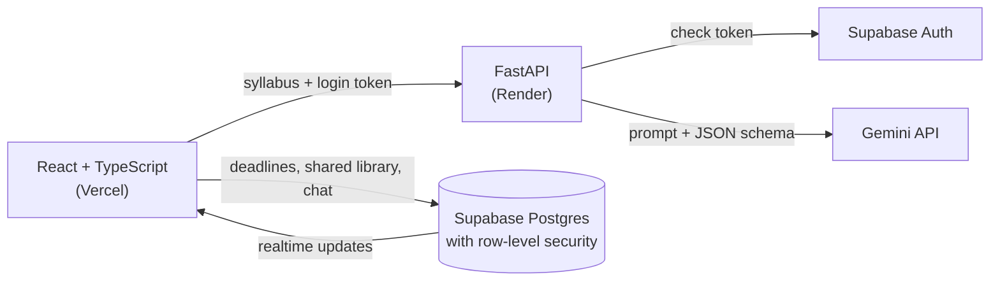

# CalendarAI Mini

Students upload a syllabus and get every deadline on a calendar, each linked to the sentence in the syllabus it came from.

**Live demo:** https://calendarai-mini.vercel.app (sign-up is limited to @ualberta.ca accounts)

<!-- Screenshot or GIF goes here -->

This was my solo prototype. It later became [Cohort](https://github.com/UndergraduateArtificialIntelligenceClub/Cohort).

## Features

- **Syllabus upload.** Paste text or upload a PDF. The PDF text is extracted on the server with `pypdf`.
- **Structured parsing with Gemini.** The model is given a JSON schema built from a Pydantic model (`DeadlineList` in [backend/main.py](backend/main.py)), and its response is validated against that model. Each deadline has a course, title, date, category and the exact source sentence.
- **Review before saving.** Each parsed deadline is shown next to the syllabus sentence it came from. Students can edit, delete or confirm it before it is saved. The source sentence stays on the deadline and is included in the .ics export.
- **Shared course library.** Students can share a parsed syllabus by course so classmates can add it without uploading it again. It shows how many classmates have used it.
- **Study buddy matching with realtime chat.** Students join a queue for a course, are paired with another student in that course, and chat live through Supabase Realtime.
- **.ics export.** Exports deadlines to Apple, Google or Outlook calendars, plus a one-click "add to Google Calendar" link for a single deadline.
- **Reminders.** A card lists deadlines due in the next 3 days. Optional browser notifications fire while the app is open in a tab.

## Architecture



- **Frontend** ([frontend/](frontend/)): React, TypeScript, Vite and FullCalendar. It talks to Supabase directly for data and auth.
- **Backend** ([backend/main.py](backend/main.py)): a single FastAPI file. It only does the parsing, so the Gemini key never reaches the browser.
- **Database** ([supabase/](supabase/)): Postgres tables, row-level security policies and SQL functions.

## Security

Based on [supabase/](supabase/) and [backend/main.py](backend/main.py):

- **Row-level security.** The SQL files in this repo define 9 policies across 4 tables:
  - `shared_syllabi`: 4 (any logged-in user can read; only the uploader can insert, update or delete)
  - `study_requests`: 2
  - `study_matches`: 1
  - `study_messages`: 2

  Students only see their own requests, matches and chats, and can only send messages in an active match they belong to. `edit_and_share.sql` also adds an update policy on `deadlines` that copies the table's existing delete rule.
- **No unauthenticated calls to Gemini.** `/parse` and `/parse-pdf` depend on `require_user`, which checks the bearer token with Supabase Auth and returns 401 if it is missing or invalid.
- **Signup restricted to @ualberta.ca.** A Supabase "Before User Created" hook ([supabase/restrict_signup.sql](supabase/restrict_signup.sql)) rejects other emails for both email/password and Google sign-in. Only the Supabase Auth role can run it.
- **No double matching.** `find_study_buddy` takes a per-course `pg_advisory_xact_lock`, so two students clicking at the same time cannot both be matched with the same person or miss each other. Matches are only created through this function. There is no insert policy on `study_matches`, so a client cannot create a fake match.

## Run locally

You need a Supabase project and a Gemini API key.

**1. Database.** In the Supabase SQL Editor, run each file in [supabase/](supabase/). Then add the signup hook under Authentication > Hooks, as described at the top of `restrict_signup.sql`.

**2. Backend** (Python 3.10+)

```bash
python -m venv venv
source venv/bin/activate
pip install -r backend/requirements.txt
cd backend
uvicorn main:app --reload
```

Environment variables in `backend/.env`:

| Name | Purpose |
| --- | --- |
| `GEMINI_API_KEY` | Gemini API key |
| `SUPABASE_URL` | Supabase project URL |
| `SUPABASE_PUBLISHABLE_KEY` | Supabase publishable key, used to check login tokens |
| `FRONTEND_URL` | Optional. Deployed frontend URL to allow through CORS |

**3. Frontend**

```bash
cd frontend
npm install
npm run dev
```

Environment variables in `frontend/.env.local`:

| Name | Purpose |
| --- | --- |
| `VITE_SUPABASE_URL` | Supabase project URL |
| `VITE_SUPABASE_PUBLISHABLE_KEY` | Supabase publishable key |
| `VITE_API_URL` | Optional. Backend URL, defaults to `http://127.0.0.1:8000` |

Both `.env` files are gitignored.
